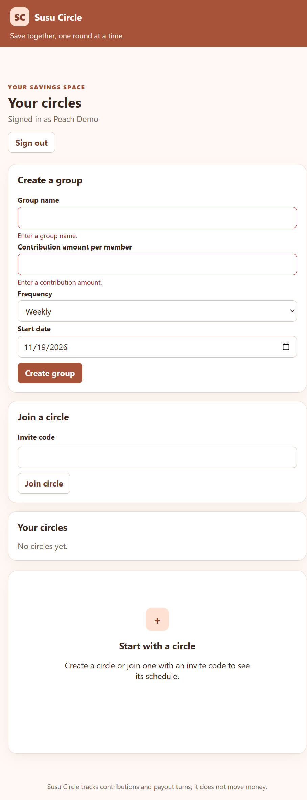
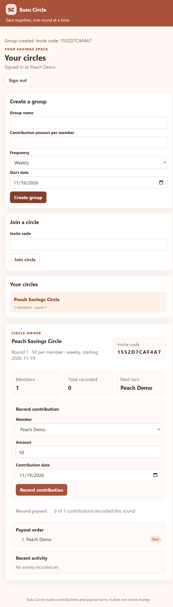
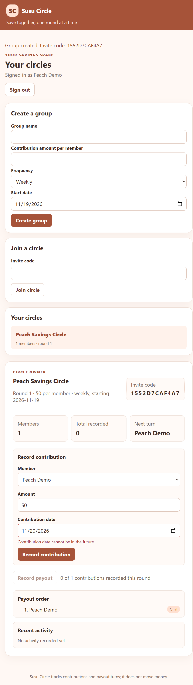
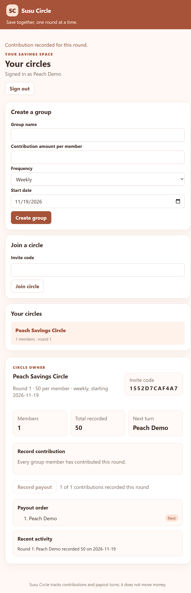

# Susu Circle - Milestone 1 and Forms

The form evidence below was captured locally using a test account. It is not a screenshot of a deployed site.

## Five answers for a new reader

1. **What is it?** A small web app for organizing a rotating savings circle.
2. **What can members do?** Create or join a circle, record contributions, and view the payout order and activity. Circle creation collects a name, amount, weekly/monthly frequency, and start date; contribution records include a member, amount, and date.
3. **How is access controlled?** Users sign in; circle routes require authentication and member-scoped queries.
4. **Does it move money?** No. It records contribution and payout entries only; it does not hold or transfer funds.
5. **How do I try it?** Follow the numbered server and client setup below. The full app has not been publicly deployed.

## Links and current status

- GitHub repository: https://github.com/SusanaSerwaaOseiPoku/susu-circle
- GitHub checks: [workflow runs](https://github.com/SusanaSerwaaOseiPoku/susu-circle/actions)
- Live site: **Pending deployment**
- Live API health URL: **Pending deployment** (`/health`)

The dashboard screenshot above is from a local run, not a live site. Do not present a localhost URL as the public link. Deployment needs a host with HTTPS and persistent storage for SQLite. The app has no separate client environment file: the static client is served by the same Express server and calls same-origin `/api` routes.

## React server exercise

The React app is in [`contexts-and-hooks/`](contexts-and-hooks/). It loads
groups, members, and contributions from `db.json` using json-server. Follow
[`contexts-and-hooks/README.md`](contexts-and-hooks/README.md) to start the API
and app in separate terminals.

## Numbered setup: server

Requirements: Node.js 20 or newer and npm.

1. Clone the repository and open PowerShell in its root folder.
2. Install the locked dependencies:

   ```powershell
   npm ci
   ```

3. Create a private environment file:

   ```powershell
   Copy-Item .env.example .env
   ```

4. Replace `SESSION_SECRET` in `.env` with a private random value of at least 32 characters. To generate one:

   ```powershell
   node -p "require('node:crypto').randomBytes(32).toString('hex')"
   ```

   Never commit `.env`; `.gitignore` excludes it. The checked-in `.env.example` contains placeholders only.

5. Build and start the production server:

   ```powershell
   npm run build
   npm start
   ```

   For development instead, use `npm run dev`.

6. Open `http://localhost:3000/health`. A working local server and database return `{"status":"ok"}`.

## Numbered setup: client, initial data, and tests

1. The browser client is in `public/`. There is no separate client build or server; Express serves it at `http://localhost:3000/`.
2. A fresh database creates its schema automatically on first startup. There is no seeded account or preset password.
3. Open the client, choose **Sign up**, and create two rehearsal accounts with non-sensitive addresses such as `owner@example.test` and `member@example.test`.
4. As the first account, create a circle with its contribution amount, frequency, and start date. Sign in as the second account in another browser/private window and join with the invite code. Use **Record contribution** to choose a member and record the agreed amount and date; only the owner can record for another member. Then have the owner record the payout.
5. Run the same automated checks used by CI:

   ```powershell
   npm run typecheck
   npm test
   npm run lint
   npm run build
   npm audit
   ```

   Tests use an in-memory SQLite database and create their own accounts; they do not depend on or seed the local `data/susu-circle.sqlite` file.

The client `.env.example` is in `public/` and explains why no browser environment values are needed. Do not put secrets in frontend files.

## API endpoint table

| Method | Path                                                    | Who                      | Success result                                               | Other important results                                                                                                                                                           |
| ------ | ------------------------------------------------------- | ------------------------ | ------------------------------------------------------------ | --------------------------------------------------------------------------------------------------------------------------------------------------------------------------------- |
| `GET`  | `/health`                                               | Anyone                   | `200` with `{"status":"ok"}` after a database query          | `500` if the database check fails                                                                                                                                                 |
| `POST` | `/api/auth/register`                                    | Anyone                   | `201` with the new user; sets a session cookie               | `400` invalid fields; `409` duplicate email                                                                                                                                       |
| `POST` | `/api/auth/login`                                       | Anyone                   | `200` with the user; sets a session cookie                   | `401` invalid email or password                                                                                                                                                   |
| `POST` | `/api/auth/logout`                                      | Anyone; session optional | `204`; deletes the current session if valid                  | -                                                                                                                                                                                 |
| `GET`  | `/api/me`                                               | Signed-in user           | `200` with the current user                                  | `401` without a session                                                                                                                                                           |
| `GET`  | `/api/groups`                                           | Signed-in user           | `200` with only that user's circles                          | `401` without a session                                                                                                                                                           |
| `POST` | `/api/groups`                                           | Signed-in user           | `201` with a new circle; creator becomes owner/member        | `400` invalid name, amount, frequency, or start date                                                                                                                              |
| `POST` | `/api/groups/join`                                      | Signed-in user           | `201` after joining by invite code                           | `400` missing code; `404` unknown code; `409` already joined or full                                                                                                              |
| `GET`  | `/api/groups/:groupId`                                  | Circle member            | `200` with circle, members, contributions, and payouts       | `400` invalid ID; `404` missing or non-member circle                                                                                                                              |
| `POST` | `/api/groups/:groupId/contributions`                    | Circle member            | `201` with recorded member, amount, and date                 | `400` invalid member/amount/date or future date; `401` unauthenticated; `403` recording for another member; `404` non-member/missing circle; `409` already contributed this round |
| `POST` | `/api/groups/:groupId/payouts`                          | Circle owner             | `201` with payout record; advances the round                 | `403` not owner; `404` non-member/missing circle; `409` too few members or contributions incomplete                                                                               |
| `GET`  | `/`                                                     | Anyone                   | `200` with the browser app                                   | -                                                                                                                                                                                 |
| `GET`  | `/groups/:groupId`                                      | Anyone                   | `200` with the browser app, including on a deep-link refresh | `404` for an invalid circle ID                                                                                                                                                    |
| `GET`  | `/app.js`, `/field.js`, `/validation.js`, `/styles.css` | Anyone                   | `200` with static client assets                              | -                                                                                                                                                                                 |
| Any    | Unknown `/api/*` path                                   | Anyone                   | -                                                            | `404` with `{"error":"API route not found"}`                                                                                                                                      |

All contribution amounts are positive whole-number units; the app does not assign a currency or process money.

## Full request and reply: two key routes

### Create a group

Request:

```http
POST /api/groups HTTP/1.1
Host: localhost:3000
Content-Type: application/json
Cookie: susu.session=<SIGNED_SESSION>

{
  "name": "Weekend Circle",
  "contributionAmount": 50,
  "frequency": "weekly",
  "startDate": "2026-11-19"
}
```

Example reply (IDs and invite code are generated):

```http
HTTP/1.1 201 Created
Content-Type: application/json

{
  "group": {
    "id": 12,
    "ownerId": 1,
    "name": "Weekend Circle",
    "inviteCode": "<GENERATED_CODE>",
    "contributionAmount": 50,
    "frequency": "weekly",
    "startDate": "2026-11-19",
    "currentRound": 1,
    "role": "owner",
    "memberCount": 1,
    "totalContributed": 0,
    "members": [
      {
        "id": 1,
        "name": "Ama Example",
        "payoutOrder": 1,
        "payoutStatus": "next",
        "totalContributed": 0
      }
    ],
    "contributions": [],
    "payouts": []
  }
}
```

### Record a circle contribution

Request (replace the ID and cookie with values from your local session):

```http
POST /api/groups/12/contributions HTTP/1.1
Host: localhost:3000
Content-Type: application/json
Cookie: susu.session=<SIGNED_SESSION>

{
  "memberId": 1,
  "amount": 50,
  "date": "2026-11-19"
}
```

Example reply:

```http
HTTP/1.1 201 Created
Content-Type: application/json

{
  "contribution": {
    "id": 1,
    "groupId": 12,
    "memberId": 1,
    "amount": 50,
    "contributionDate": "2026-11-19",
    "round": 1,
    "createdAt": "2026-11-19T12:00:00.000Z"
  }
}
```

These are illustrative local examples; replace the session placeholder with your own signed-in session.

## Form screenshots

The reusable `Field` component and plain validation functions are in `public/field.js` and `public/validation.js`. Both forms show field-level errors and reset after a successful submit.

### Create group

Validation error:



Successful submit and group detail:



### Record contribution

Validation error for a future date:



Successful submit:



## Security and project limits

Passwords are scrypt-hashed. Session IDs are signed in the cookie and stored as hashes in SQLite. Protected routes check authentication and circle membership; SQL queries use parameters. Production use still needs HTTPS, a strong private secret, a durable database disk, operational backups/monitoring, and an independent security review. This class MVP is not a financial service.

## Presentation materials

- [30-second explanation](submission/30-second-explanation.md)
- [Pre-submission checklist and score template](submission/readiness-checklist.md)
- [Rubric-by-rubric score template](submission/self-score.md)
- [Fresh-clone report](submission/fresh-clone-report.md)
- [Vibe Coding Log](submission/vibe-coding-log.md)
- [Five-minute presentation outline](submission/presentation-outline.md)

The explanation is an AI draft: review it and rehearse it in your own words. The official rubric and your personal self-score were not provided, so the score template is intentionally unfilled.
