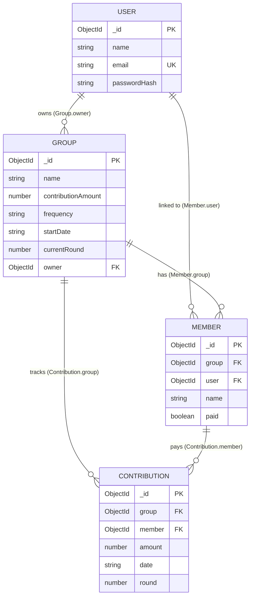

# Susu Circle API (MongoDB Relationships, Populate & Pagination)

An Express + Mongoose API for the Susu Circle React app with connected MongoDB
collections (`User`, `Group`, `Member`, `Contribution`), `ref` + `.populate()`,
server-calculated totals, `checkOwner` authorization, search, sorting, and
pagination.

## Collections Relationship Diagram



### Every `.populate()` explained

| Endpoint | Populate call | What it resolves (and why it's safe) |
| --- | --- | --- |
| `GET /groups`, `GET /groups/mine`, `GET /groups/:id` | `.populate("owner", "email")` | Replaces the `owner` ObjectId with `{ _id, email }` from `User` — explicitly projecting `"email"` so `passwordHash` is never returned. |
| `GET /groups`, `GET /groups/mine`, `GET /groups/:id` | `.populate("memberCount")` | Uses the `memberCount` virtual (`ref: "Member"`, `localField: "_id"`, `foreignField: "group"`, `count: true`) to attach how many members belong to each group. |
| `GET /groups/:id/contributions`, `GET /contributions` | `.populate("member", "name paid")` | Resolves each contribution's `member` ObjectId into the member's live `{ _id, name, paid }`. |
| `GET /groups/:id/members`, `GET /members` | `.populate("user", "email")` | Resolves the optional `user` ref on `Member` to `{ _id, email }` with no secrets. |

## Setup with MongoDB Atlas

Requirements: Node.js 20 or newer, npm, and a free MongoDB Atlas cluster.

1. Copy `.env.example` to `.env` and fill in `JWT_SECRET` and your Atlas `MONGO_URI`:

```sh
cp .env.example .env
```

2. Install dependencies and start the server (`connectDB()` runs before `app.listen()`):

```sh
npm install
npm run dev
```

The API listens at `http://localhost:3001`. `.env` is ignored in `.gitignore`.

## Endpoints

Protected routes require `Authorization: Bearer <token>`.

| Method | Path | Access | Notes |
| --- | --- | --- | --- |
| `POST` | `/auth/register` | **Public** | Hashes password with `bcryptjs`; `409` on repeated email |
| `POST` | `/auth/login` | **Public** | Returns `{ token, user }`; `401` on wrong details |
| `GET` | `/auth/me` | **Protected** (`requireAuth`) | Returns logged-in `{ user }` without secrets |
| `GET` | `/groups` | **Public** | Populates `owner.email` & `memberCount`; supports `?search=`, `?sort=` (`newest`, `oldest`, `name`, `-name`, `amount`, `-amount`), `?page=`, `?limit=`; returns `{ groups, pagination }` |
| `GET` | `/groups/mine` | **Protected** (`requireAuth`) | Mounted **above** `/:id`; returns only groups owned by the logged-in user (populated + paginated) |
| `GET` | `/groups/:id` | **Public** | Uses `findGroup` (`Group.findById`); `400` bad ID, `404` missing |
| `GET` | `/groups/:id/members` | **Public** | Lists members of the group with populated `user.email` |
| `GET` | `/groups/:id/contributions` | **Public** | Populates each contribution's `member.name` and returns `{ group, contributions, totalSaved }` (total computed on the server) |
| `POST` | `/groups` | **Protected** (`requireAuth`) | Saves `owner: req.user.id` |
| `PATCH` | `/groups/:id` | **Protected** (`requireAuth` + `checkOwner`) | Only the owner may update (`403` otherwise) |
| `DELETE` | `/groups/:id` | **Protected** (`requireAuth` + `checkOwner`) | Only the owner may delete (`403` otherwise); cleans up related members & contributions |
| `GET` | `/members` | **Public** | Optional `?group=` / `?groupId=` filter; populates `group` and `user` |
| `POST` | `/members` | **Protected** (`requireAuth`) | Saves `group` and `user` refs |
| `PATCH` | `/members/:id` | **Protected** (`requireAuth`) | Updates `paid` / `status` |
| `DELETE` | `/members/:id` | **Protected** (`requireAuth`) | Removes member while retaining contribution history |
| `GET` | `/contributions` | **Public** | Optional `?group=` / `?groupId=` filter; populates `member` and `group` |
| `POST` | `/contributions` | **Protected** (`requireAuth`) | Saves `group` and `member` refs and marks member paid |

## Test (`vitest` + `supertest`)

`app.js` is split from `server.js` so Supertest can test Express without
binding a live port while `npm start` continues starting Render cleanly.

```sh
npm test
```

- Uses `vitest.config.js` + `test/setup.js` against a `susu-test` database
  (`MONGO_URI_TEST` in `.env.example`, with a `-test` suffix safety guard and
  automatic in-memory `susu-test` fallback). Every collection is emptied after
  each test.
- Covers **20 tests** across `test/contributions.unit.test.js` (5 unit tests),
  `test/auth.test.js` (5 auth tests), and `test/groups-contributions.test.js`
  (10 integration & failure tests: `400` validation, `401` unauthenticated,
  `403` non-owner, `400` bad ID, `404` missing group).
